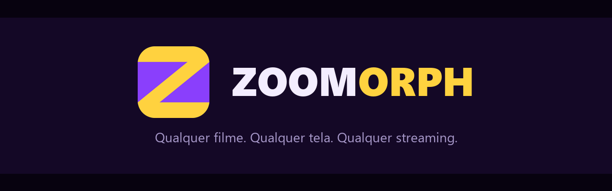
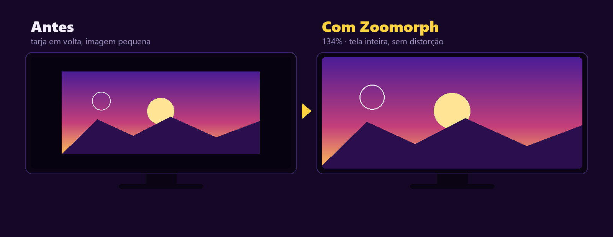
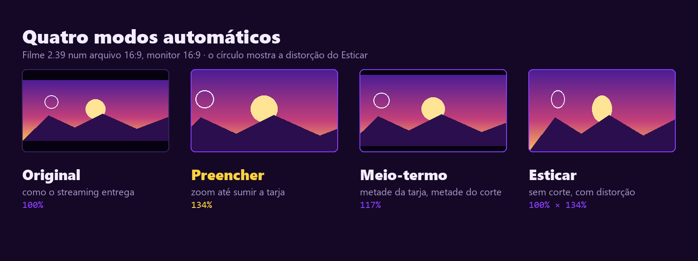
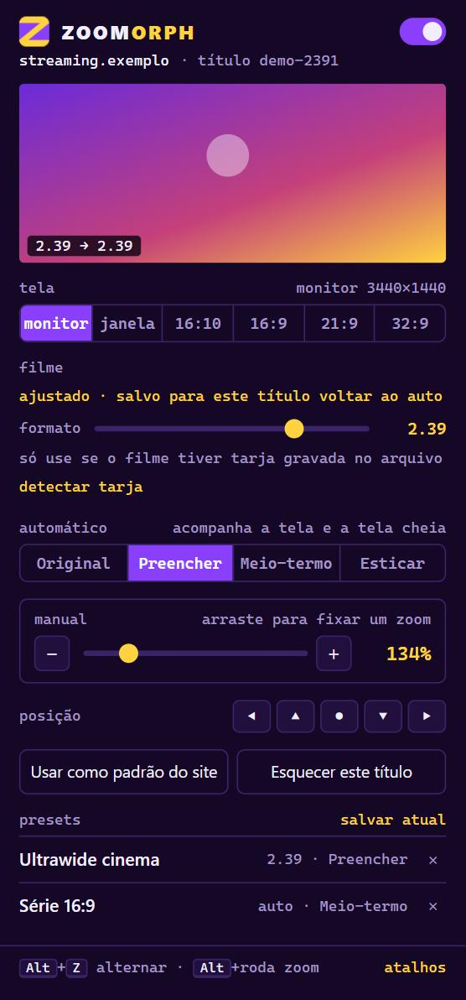
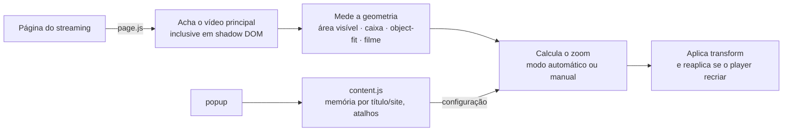

<p align="center">
  
</p>

<p align="center">
  <a href="https://github.com/Pedroooxx/zoomorph/releases/latest"></a>
  <a href="https://github.com/Pedroooxx/zoomorph/releases/latest"></a>
  
  <a href="LICENSE"></a>
</p>

<p align="center">
  <a href="https://microsoftedge.microsoft.com/addons/detail/npkglikcgcbfnelmiimhjcmnmmabjlka"></a>
  <a href="https://addons.opera.com/extensions/details/zoomorph/"></a>
  
</p>

<h3 align="center">O filme na tela inteira, sem tarja preta.</h3>

<p align="center">
  O Zoomorph lê o tamanho da sua tela e o formato do vídeo e aplica <b>só o zoom necessário</b>.<br>
  Nada de adivinhar porcentagem: o ajuste acompanha a tela cheia e fica lembrado para cada filme.
</p>

<p align="center">
  <a href="https://github.com/Pedroooxx/zoomorph/releases/latest"><b>⬇ Baixar</b></a> &nbsp;·&nbsp;
  <a href="https://pedroooxx.github.io/zoomorph/"><b>Site</b></a> &nbsp;·&nbsp;
  <a href="https://pedroooxx.github.io/zoomorph/demo/popup.html"><b>Demonstração interativa</b></a> &nbsp;·&nbsp;
  <a href="#english"><b>English</b></a>
</p>

<br>

<p align="center">
  
</p>

## Sumário

- [Por que existe](#por-que-existe)
- [Recursos](#recursos)
- [Instalar](#instalar)
- [Como usar](#como-usar)
- [Atalhos](#atalhos)
- [Compatibilidade](#compatibilidade)
- [Como funciona](#como-funciona)
- [Perguntas frequentes](#perguntas-frequentes)
- [Contribuir](#contribuir)
- [Identidade visual](#identidade-visual)

## Por que existe

Filmes de cinema são mais largos que a maioria das telas. Os streamings entregam esses filmes com faixas pretas em cima e embaixo, e num monitor ultrawide muitas vezes também nas laterais. As extensões de zoom comuns pedem uma porcentagem, não acompanham a mudança para tela cheia, e várias nem encontram o vídeo em sites como a Disney+.

O Zoomorph mede o que aparece de fato na tela (o player, o arquivo de vídeo e o filme dentro dele) e aplica só o necessário. **Se o vídeo já cobre a tela, ele fica em 100%.**

## Recursos

<p align="center">
  
</p>

<table>
  <tr>
    <td width="50%" valign="top">
      <h4>🎯 Zoom calculado</h4>
      Lê a tela (monitor, janela do player ou uma proporção fixa) e o formato do vídeo. Recalcula ao entrar e sair da tela cheia.
    </td>
    <td width="50%" valign="top">
      <h4>🎚️ Automático ou manual</h4>
      Quatro modos automáticos e, separado deles, um zoom manual fixo de 100% a 300%. Um nunca interfere no outro.
    </td>
  </tr>
  <tr>
    <td valign="top">
      <h4>🎞️ Tarja gravada no arquivo</h4>
      No YouTube e em outros sites sem proteção, a tarja dentro do arquivo é detectada sozinha. Nos com DRM, ajuste o formato uma vez e ele fica salvo.
    </td>
    <td valign="top">
      <h4>🧠 Lembra cada filme</h4>
      O ajuste fica salvo por título. O modo pode virar padrão do site, e os presets com nome valem em qualquer lugar.
    </td>
  </tr>
  <tr>
    <td valign="top">
      <h4>⌨️ Atalhos e aviso na tela</h4>
      <kbd>Alt</kbd>+<kbd>Z</kbd> alterna, <kbd>Alt</kbd>+roda ajusta. Um aviso discreto aparece até em tela cheia, e o zoom aparece no ícone.
    </td>
    <td valign="top">
      <h4>🔒 Privado</h4>
      Sem conta, sem servidor, sem análise de uso. Tudo fica no seu navegador. <a href="PRIVACY.md">Política de privacidade</a>.
    </td>
  </tr>
</table>

## Instalar

### Pelas lojas (atualiza sozinho)

| Navegador | Loja | Situação |
|---|---|---|
| Microsoft Edge | [Edge Add-ons](https://microsoftedge.microsoft.com/addons/detail/npkglikcgcbfnelmiimhjcmnmmabjlka) | Em revisão pela Microsoft |
| Opera | [Opera Add-ons](https://addons.opera.com/extensions/details/zoomorph/) | Em revisão pela Opera |
| Chrome, Brave e outros | Chrome Web Store | Em breve |

> [!NOTE]
> Os links das lojas passam a funcionar quando a revisão terminar. Até lá, ou no Chrome, instale pelo arquivo.

### Pelo arquivo

1. Baixe o **`zoomorph-<versão>.zip`** na [página de versões](https://github.com/Pedroooxx/zoomorph/releases/latest) e extraia numa pasta.
2. Abra a página de extensões do navegador:

   | Chrome | Opera | Edge | Brave |
   |---|---|---|---|
   | `chrome://extensions` | `opera://extensions` | `edge://extensions` | `brave://extensions` |

3. Ative o **Modo do desenvolvedor**.
4. Clique em **Carregar sem compactação** e escolha a pasta extraída.

Para atualizar, troque os arquivos da pasta e clique em recarregar (⟳) no card da extensão. As abas abertas passam a usar a versão nova sozinhas.

## Como usar



1. Dê play no filme e clique no ícone do Zoomorph.
2. Em **automático**, escolha **Preencher**. O ajuste fica salvo para esse título.
3. Ainda sobrou tarja? Ela está gravada no arquivo. No YouTube e em outros sites sem proteção ela é detectada sozinha em alguns segundos; nos com DRM, arraste **formato** até ela sumir.
4. Quer o mesmo modo em todos os títulos do site? Clique em **Usar como padrão do site**.
5. Prefere um zoom fixo? Arraste a barra **manual**. Para voltar ao automático, clique num dos modos.

Experimente sem instalar: [demonstração interativa](https://pedroooxx.github.io/zoomorph/demo/popup.html).

<br clear="right">

## Atalhos

| Atalho | Ação |
|---|---|
| <kbd>Alt</kbd> + <kbd>Z</kbd> | Alterna entre o ajuste salvo e o original |
| <kbd>Alt</kbd> + <kbd>X</kbd> | Troca o formato do filme |
| <kbd>Alt</kbd> + <kbd>M</kbd> | Troca o modo automático |
| <kbd>Alt</kbd> + <kbd>↑</kbd> <kbd>↓</kbd> ou <kbd>Alt</kbd> + roda do mouse | Zoom manual de 2 em 2% |
| <kbd>Alt</kbd> + <kbd>Shift</kbd> + setas | Move a imagem, sem nunca mostrar a borda |
| <kbd>Alt</kbd> + <kbd>D</kbd> | Copia um diagnóstico para relatar problemas (funciona em tela cheia) |

Os três primeiros podem ser trocados na página de atalhos do navegador (link **atalhos** no rodapé do popup).

## Compatibilidade

| Streaming | Situação |
|---|---|
| Disney+ | ✅ testado |
| Prime Video | ✅ testado |
| Netflix · Max · Apple TV+ · Paramount+ · Globoplay · Crunchyroll | 🟡 reconhecidos, aguardando testes |
| YouTube | ✅ testado, com detecção automática de tarja |
| Vimeo · Twitch · qualquer site com `<video>` | 🟡 modo genérico |

Testou em algum? [Conte como foi](https://github.com/Pedroooxx/zoomorph/issues/new/choose). Para anexar o diagnóstico, aperte <kbd>Alt</kbd>+<kbd>D</kbd> com o vídeo tocando e cole na issue.

## Como funciona



O zoom é o necessário para a **parte visível do filme** cobrir a **área de referência**:

- **área de referência:** a tela, em tela cheia; fora dela, um retângulo com a proporção do monitor dentro do player. Assim a janela mostra o mesmo corte da tela cheia.
- **parte visível do filme:** o filme dentro do arquivo, posicionado conforme o `object-fit` do site e recortado pela caixa do vídeo.

| Arquivo | Papel |
|---|---|
| [`src/page.js`](src/page.js) | Roda no contexto da página: acha o vídeo, mede e aplica o zoom |
| [`src/content.js`](src/content.js) | Preferências, memória, atalhos e aviso na tela |
| [`src/adapters.js`](src/adapters.js) | Como cada streaming identifica o título na URL |
| [`popup/`](popup) | Interface |
| [`background.js`](background.js) | Atalhos globais, zoom no ícone, ativação em abas já abertas |

## Perguntas frequentes

<details>
<summary><b>Por que a detecção de tarja não funciona na Netflix, na Disney+ e no Prime?</b></summary>

Esses sites protegem o vídeo com DRM, e o navegador não deixa nenhuma extensão ler a imagem. Neles, o Zoomorph usa o formato do arquivo e o que você salvou para o título. Ajuste uma vez com a barra **formato** e o filme volta certo da próxima vez.

No YouTube, no Vimeo e em outros sites sem DRM, a tarja gravada no arquivo é detectada sozinha no formato **auto**.
</details>

<details>
<summary><b>O popup diz "Nenhum vídeo encontrado".</b></summary>

Confira se o vídeo está tocando e clique em **Procurar de novo**. Se a aba foi aberta antes de instalar a extensão, clique em **Recarregar página**.
</details>

<details>
<summary><b>Por que o zoom é diferente na janela e na tela cheia?</b></summary>

Não deveria ser: no modo **monitor**, que é o padrão, a janela mostra o mesmo corte da tela cheia. Se você escolheu **janela**, o zoom preenche exatamente o player, que pode ter outra proporção.
</details>

<details>
<summary><b>A extensão coleta algum dado?</b></summary>

Não. Os ajustes ficam em `chrome.storage.local`, no seu navegador. Veja a <a href="PRIVACY.md">política de privacidade</a>.
</details>

## Contribuir

Ideias, testes em outros streamings e correções são bem-vindos. Veja o [guia de contribuição](CONTRIBUTING.md).

```bash
git clone https://github.com/Pedroooxx/zoomorph.git
cd zoomorph
python build.py      # gera dist/zoomorph-<versão>.zip e demo/popup.html
```

## Identidade visual


O símbolo é um **Z** montado com as peças do problema: as duas barras amarelas são as tarjas pretas, e o traço diagonal é a diagonal da tela, a medida das polegadas. O roxo é a imagem, e o amarelo é tudo o que é ação.

<br clear="left">

| Cor | Hex | Uso |
|---|---|---|
|  Noite | `#140826` | Fundo |
|  Roxo | `#8a3ffc` | Marca, seleção |
|  Amarelo | `#ffd23f` | Ação, valores |
|  Texto | `#f3edff` | Texto principal |
|  Secundário | `#a596c7` | Texto de apoio |

## Licença

[MIT](LICENSE) © Pedroooxx

---

<a id="english"></a>

## English

**Zoomorph** removes black bars from streaming movies. It reads your screen and the video format and applies only the zoom that's needed: fill, half-way, stretch or a fixed manual zoom. It follows you into fullscreen, remembers each title and collects no data.

- **Works on:** Chrome, Opera, Edge and Brave (Manifest V3); Disney+, Prime Video, Netflix, Max, YouTube and any site with a `<video>`.
- **Install:** from [Edge Add-ons](https://microsoftedge.microsoft.com/addons/detail/npkglikcgcbfnelmiimhjcmnmmabjlka) or [Opera Add-ons](https://addons.opera.com/extensions/details/zoomorph/) (in review), Chrome Web Store coming soon. Or download the zip from [Releases](https://github.com/Pedroooxx/zoomorph/releases/latest) and extract it. Open `chrome://extensions` (or `opera://`, `edge://`), enable **Developer mode** and click **Load unpacked**.
- **Shortcuts:** <kbd>Alt</kbd>+<kbd>Z</kbd> toggles, <kbd>Alt</kbd>+<kbd>X</kbd> cycles the film ratio, <kbd>Alt</kbd>+<kbd>M</kbd> cycles the mode, and <kbd>Alt</kbd>+mouse wheel sets a manual zoom.
- **Try it:** [interactive demo](https://pedroooxx.github.io/zoomorph/demo/popup.html).
