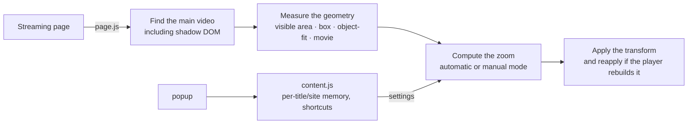

<p align="right"><b>English</b> · <a href="README.pt-BR.md">Português</a></p>

<p align="center">
  
</p>

<p align="center">
  <a href="https://github.com/Pedroooxx/zoomorph/releases/latest"></a>
  <a href="https://github.com/Pedroooxx/zoomorph/releases/latest"></a>
  
  <a href="LICENSE"></a>
</p>

<p align="center">
  <a href="https://microsoftedge.microsoft.com/addons/detail/npkglikcgcbfnelmiimhjcmnmmabjlka"></a>
  <a href="https://addons.opera.com/extensions/details/zoomorph/"></a>
  
</p>

<h3 align="center">Movies on your whole screen, with no black bars.</h3>

<p align="center">
  Zoomorph reads your screen size and the video format and applies <b>only the zoom that's needed</b>.<br>
  No guessing percentages: it follows you into fullscreen and remembers each movie.
</p>

<p align="center">
  <a href="https://github.com/Pedroooxx/zoomorph/releases/latest"><b>⬇ Download</b></a> &nbsp;·&nbsp;
  <a href="https://pedroooxx.github.io/zoomorph/"><b>Website</b></a> &nbsp;·&nbsp;
  <a href="https://pedroooxx.github.io/zoomorph/demo/popup.html"><b>Interactive demo</b></a>
</p>

<br>

<p align="center">
  
</p>

## Contents

- [Why it exists](#why-it-exists)
- [Features](#features)
- [Install](#install)
- [How to use](#how-to-use)
- [Shortcuts](#shortcuts)
- [Compatibility](#compatibility)
- [How it works](#how-it-works)
- [FAQ](#faq)
- [Contributing](#contributing)
- [Visual identity](#visual-identity)

## Why it exists

Cinema movies are wider than most screens. Streaming services deliver them with black bars above and below, and on an ultrawide monitor often on the sides too. Typical zoom extensions ask for a percentage, don't adapt when you go fullscreen, and several can't even find the video on sites like Disney+.

Zoomorph measures what is actually on screen (the player, the video file and the movie inside it) and applies only what's needed. **If the video already covers the screen, it stays at 100%.**

## Features

<p align="center">
  
</p>

<table>
  <tr>
    <td width="50%" valign="top">
      <h4>🎯 Calculated zoom</h4>
      Reads the screen (monitor, player window or a fixed ratio) and the video format. Recalculates when you enter or leave fullscreen.
    </td>
    <td width="50%" valign="top">
      <h4>🎚️ Automatic or manual</h4>
      Four automatic modes and, separately, a fixed manual zoom from 100% to 300%. One never interferes with the other.
    </td>
  </tr>
  <tr>
    <td valign="top">
      <h4>🎞️ Bars baked into the file</h4>
      On YouTube and other DRM-free sites, letterboxing inside the file is detected automatically. On DRM sites, set the format once and it's saved.
    </td>
    <td valign="top">
      <h4>🧠 Remembers each movie</h4>
      Settings are saved per title. A mode can become a site's default, and named presets work everywhere.
    </td>
  </tr>
  <tr>
    <td valign="top">
      <h4>⌨️ Shortcuts and on-screen indicator</h4>
      <kbd>Alt</kbd>+<kbd>Z</kbd> toggles, <kbd>Alt</kbd>+wheel adjusts. A discreet indicator shows even in fullscreen, and the zoom appears on the toolbar icon.
    </td>
    <td valign="top">
      <h4>🔒 Private</h4>
      No account, no server, no analytics. Everything stays in your browser. <a href="PRIVACY.md">Privacy policy</a>.
    </td>
  </tr>
</table>

## Install

### From the stores (auto-updates)

| Browser | Store | Status |
|---|---|---|
| Microsoft Edge | [Edge Add-ons](https://microsoftedge.microsoft.com/addons/detail/npkglikcgcbfnelmiimhjcmnmmabjlka) | In review by Microsoft |
| Opera | [Opera Add-ons](https://addons.opera.com/extensions/details/zoomorph/) | In review by Opera |
| Chrome, Brave and others | Chrome Web Store | Coming soon |

> [!NOTE]
> Store links start working once the review is complete. Until then, or on Chrome, install from the file.

### From the file

1. Download **`zoomorph-<version>.zip`** from the [releases page](https://github.com/Pedroooxx/zoomorph/releases/latest) and extract it to a folder.
2. Open your browser's extensions page:

   | Chrome | Opera | Edge | Brave |
   |---|---|---|---|
   | `chrome://extensions` | `opera://extensions` | `edge://extensions` | `brave://extensions` |

3. Turn on **Developer mode**.
4. Click **Load unpacked** and choose the extracted folder.

To update, replace the folder's files and click reload (⟳) on the extension card. Open tabs switch to the new version automatically.

> [!NOTE]
> The extension's interface is currently in Portuguese (Brazil). The labels used below are translated for reference.

## How to use


1. Play the movie and click the Zoomorph icon.
2. Under **automático** (automatic), choose **Preencher** (Fill). The setting is saved for that title.
3. Bars still showing? They're baked into the file. On YouTube and other DRM-free sites they're detected automatically within a few seconds; on DRM sites, drag **formato** (format) until they disappear.
4. Want the same mode for every title on the site? Click **Usar como padrão do site** (use as site default).
5. Prefer a fixed zoom? Drag the **manual** slider. To go back to automatic, click one of the modes.

Try it without installing: [interactive demo](https://pedroooxx.github.io/zoomorph/demo/popup.html).

<br clear="right">

## Shortcuts

| Shortcut | Action |
|---|---|
| <kbd>Alt</kbd> + <kbd>Z</kbd> | Toggle between your setting and the original |
| <kbd>Alt</kbd> + <kbd>X</kbd> | Cycle the movie format |
| <kbd>Alt</kbd> + <kbd>M</kbd> | Cycle the automatic mode |
| <kbd>Alt</kbd> + <kbd>↑</kbd> <kbd>↓</kbd> or <kbd>Alt</kbd> + mouse wheel | Manual zoom in 2% steps |
| <kbd>Alt</kbd> + <kbd>Shift</kbd> + arrows | Move the picture, never revealing the edge |
| <kbd>Alt</kbd> + <kbd>D</kbd> | Copy a diagnostic for bug reports (works in fullscreen) |

The first three can be changed on your browser's shortcuts page (the **atalhos** link in the popup footer).

## Compatibility

| Service | Status |
|---|---|
| Disney+ | ✅ tested |
| Prime Video | ✅ tested |
| YouTube | ✅ tested, with automatic letterbox detection |
| Netflix · Max · Apple TV+ · Paramount+ · Globoplay · Crunchyroll | 🟡 recognized, awaiting tests |
| Vimeo · Twitch · any site with a `<video>` | 🟡 generic mode |

Tried it somewhere? [Tell us how it went](https://github.com/Pedroooxx/zoomorph/issues/new/choose). To attach a diagnostic, press <kbd>Alt</kbd>+<kbd>D</kbd> while the video plays and paste it into the issue.

## How it works



The zoom is whatever the **visible part of the movie** needs to cover the **reference area**:

- **reference area:** the screen, in fullscreen; otherwise the player, never zooming more than fullscreen would need.
- **visible part of the movie:** the movie inside the file (letterboxing detected or set by the user), placed according to the site's `object-fit` and clipped by the video box.

| File | Role |
|---|---|
| [`src/page.js`](src/page.js) | Runs in the page context: finds the video, measures and applies the zoom, detects letterboxing |
| [`src/content.js`](src/content.js) | Preferences, memory, shortcuts and on-screen indicator |
| [`src/adapters.js`](src/adapters.js) | How each streaming service identifies a title in the URL |
| [`popup/`](popup) | Interface |
| [`background.js`](background.js) | Global shortcuts, zoom badge, activation in already open tabs |

## FAQ

<details>
<summary><b>Why doesn't letterbox detection work on Netflix, Disney+ and Prime Video?</b></summary>

Those sites protect the video with DRM, and the browser doesn't let any extension read the picture. There, Zoomorph uses the file's format and whatever you saved for the title. Set it once with the **formato** slider and the movie comes back right next time.

On YouTube, Vimeo and other DRM-free sites, letterboxing baked into the file is detected automatically in **auto** format.
</details>

<details>
<summary><b>The popup says no video was found.</b></summary>

Make sure the video is playing and click **Procurar de novo** (search again). If the tab was opened before installing the extension, click **Recarregar página** (reload page).
</details>

<details>
<summary><b>Why is the zoom different in a window and in fullscreen?</b></summary>

In a window, Zoomorph fills the player but never zooms more than fullscreen would need, so a player wider than your monitor doesn't crop the picture for nothing. In fullscreen it fills the screen.
</details>

<details>
<summary><b>Does the extension collect any data?</b></summary>

No. Settings live in `chrome.storage.local`, in your browser. Letterbox detection analyses a 160 px thumbnail locally and nothing is stored or sent. See the <a href="PRIVACY.md">privacy policy</a>.
</details>

## Contributing

Ideas, tests on other streaming services and fixes are welcome. See the [contributing guide](CONTRIBUTING.md).

```bash
git clone https://github.com/Pedroooxx/zoomorph.git
cd zoomorph
python build.py      # builds dist/zoomorph-<version>.zip and demo/popup.html
```

## Visual identity


The symbol is a **Z** built from the pieces of the problem: the two yellow bars are the black bars, and the diagonal stroke is the screen diagonal, the measure of its inches. Purple is the picture; yellow is everything that is an action.

<br clear="left">

| Color | Hex | Use |
|---|---|---|
|  Night | `#140826` | Background |
|  Purple | `#8a3ffc` | Brand, selection |
|  Yellow | `#ffd23f` | Actions, values |
|  Text | `#f3edff` | Main text |
|  Muted | `#a596c7` | Secondary text |

## License

[MIT](LICENSE) © Pedroooxx
